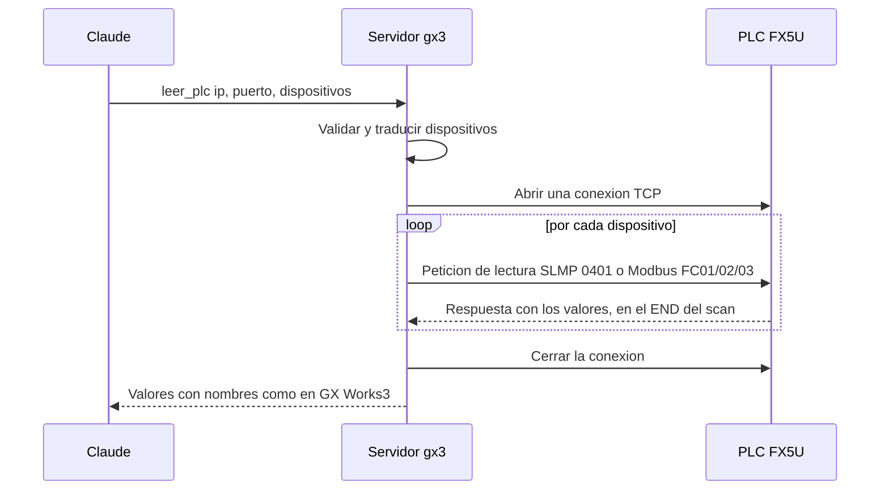
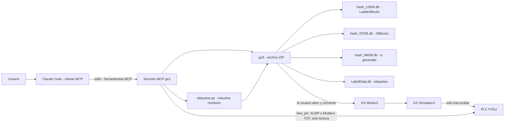
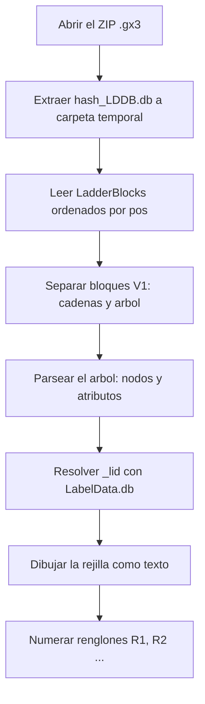
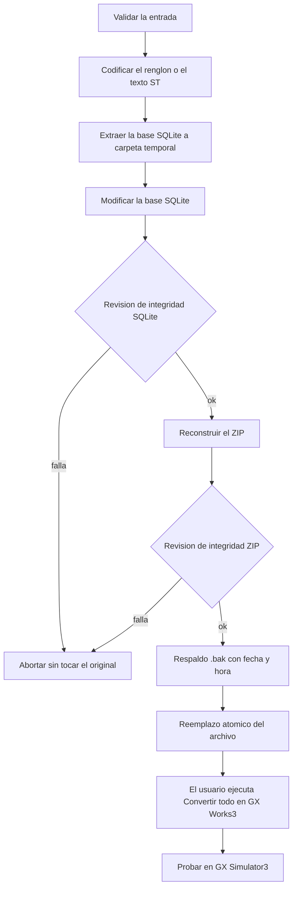
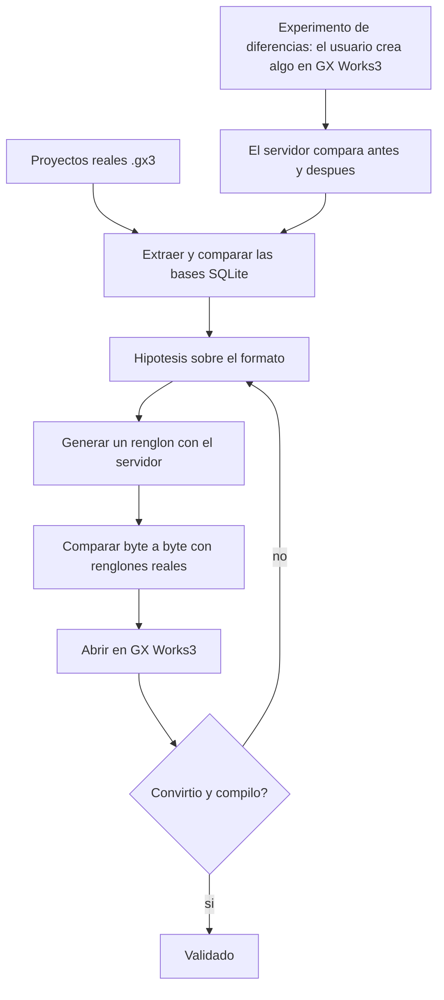
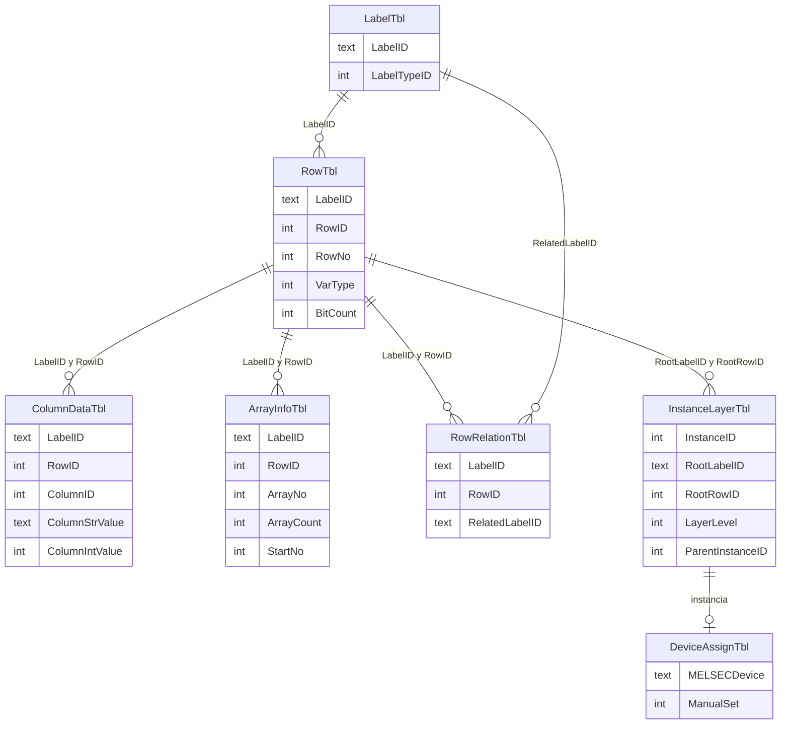

# gx3-mcp: servidor MCP para proyectos GX Works3 (.gx3)

Servidor **MCP** (Model Context Protocol) en Python que permite a Claude (Claude Code o cualquier cliente MCP) **leer y editar directamente proyectos Mitsubishi GX Works3** (archivos `.gx3`, PLC MELSEC iQ-F / FX5U): listar programas, leer y editar código ST, leer ladder como texto, consultar etiquetas y agregar o borrar renglones ladder. También **lee en vivo el PLC** por Ethernet (SLMP o Modbus/TCP), en modo solo lectura.

El formato `.gx3` no está documentado. Se entendió analizando proyectos reales (ingeniería inversa) y se validó abriendo los resultados en GX Works3, donde convirtieron y compilaron correctamente.

> [!WARNING]
> **Proyecto no oficial, sin relación con Mitsubishi Electric.**
> MELSEC y GX Works3 son marcas de Mitsubishi Electric.
> **Úsalo bajo tu propio riesgo.** Nunca descargues a un PLC que controle maquinaria real un programa que no hayas probado antes (por ejemplo en GX Simulator3).

## Contenido

- [Qué puede hacer](#qué-puede-hacer)
- [Qué no puede hacer todavía](#qué-no-puede-hacer-todavía)
- [Requisitos e instalación](#requisitos-e-instalación)
- [Ejemplos de uso](#ejemplos-de-uso)
- [Lectura en vivo del PLC](#lectura-en-vivo-del-plc)
- [Cómo funciona](#cómo-funciona)
- [Formato .gx3 en resumen](#formato-gx3-en-resumen)
- [Seguridad y validación](#seguridad-y-validación)
- [Estructura del repositorio](#estructura-del-repositorio)
- [Hoja de ruta](#hoja-de-ruta)
- [Contribuir](#contribuir)
- [Licencia](#licencia)

## Qué puede hacer

| Herramienta | Qué hace | Ejemplo de petición |
|---|---|---|
| `listar_programas` | Lista los programas del `.gx3`: id, lenguaje (ST o LD) y primera línea ST. | "Qué programas tiene el proyecto?" |
| `leer_st` | Devuelve el código ST completo de un programa, con líneas numeradas. | "Muéstrame el programa ST de la bomba." |
| `editar_st` | Reemplaza un texto (debe aparecer una sola vez) por otro y guarda en un archivo de salida. | "Cambia el límite `100` por `150` en ese ST." |
| `leer_ld` | Muestra un programa ladder como texto: comentarios, renglones dibujados (`R1`, `R2`...) y `END`. | "Léeme el ladder del programa principal." |
| `leer_etiquetas` | Lista etiquetas globales, estructuras con sus miembros, etiquetas locales por programa o FB y los dispositivos asignados a mano. | "Qué etiquetas globales hay y a qué dispositivo apuntan?" |
| `agregar_renglon_ld` | Agrega un renglón con comentario, al final (antes de `END`) o antes de un renglón dado. | "Agrega arranque/paro de Y0 con X0, X1 y enclavamiento." |
| `borrar_renglon_ld` | Borra el renglón `R<n>` y el comentario que tiene encima. | "Borra el renglón R3." |
| `revisar_ld` | Revisa todo el proyecto (o un programa): dobles bobinas, `OUT` mezclado con `SET`/`RST`, `SET` sin `RST` (considera `ZRST` de rangos), timers usados sin su `OUT`, salidas `Y` que nadie escribe y timers/contadores FB llamados dentro de `IF` en ST. Distingue locales con el mismo nombre en programas distintos. | "Revisa el proyecto." |
| `referencia_cruzada` | Dónde se usa cada dispositivo o etiqueta en ladder y ST, y con qué rol (contacto, bobina, SET, RST, fuente, destino, argumento de FB, lectura o escritura ST). | "¿Dónde se usa X1?" |
| `leer_plc` | Lee en vivo dispositivos del PLC por SLMP o Modbus/TCP (**solo lectura**). | "Lee X0 a X7, Y0 a Y4 y el valor actual de T0." |
| `monitorear_ld` | Dibuja el ladder con el estado **en vivo** del PLC, como el monitor de GX Works3: `■` conduce o está activo, `□` no. Las comparaciones e instrucciones muestran sus valores. | "Monitorea el programa principal." |
| `estado_plc` | Diagnóstico de la CPU: RUN/STOP, error y su hora, batería, caída de alimentación, tiempos de ciclo y reloj. | "¿Cómo está el PLC?" |
| `diagnosticar_modbus_rtu` | Diagnóstico de los canales serie MODBUS RTU (`ADPRW`): modo, formato (bps/paridad), reintentos, timeouts y el último error traducido (por ejemplo `7309H` = el esclavo no responde, `730AH` con su excepción). | "¿Por qué no responde el sensor del CH1?" |
| `simular_ld` | Ejecuta un programa ladder **sin PLC**, ciclo a ciclo, con los pasos que le indiques (`{"X0": 1}`, `{"segundos": 3}`...). Reporta los dispositivos después de cada paso y avisa lo que no puede simular (ST, FB, instrucciones no soportadas). | "Simula: pulso X0, espera 3 s, activa X1. ¿Qué hace Y0?" |
| `escribir_plc` | **Escribe** dispositivos en el PLC por SLMP (`1401`) y los relee para confirmar. Solo dentro de los rangos de la variable de entorno `GX3_ESCRITURA_PERMITIDA`; sin ella no escribe nada. | "Pon D100 en 25." |

Lo que `agregar_renglon_ld` sabe escribir:

- Contactos: `X0` (NA), `/X0` (NC), `↑X0` (flanco de subida), `↓X0` (flanco de bajada), comparaciones de 16 bits (`>= D10 K100`, con `=`, `<>`, `>`, `<`, `>=`, `<=`) y comparaciones REAL (`E< D10 E17.5`).
- Salidas: `Y0` (bobina), `SET M0`, `RST M0`, `OUT T0 K30` (temporizador de 100 ms), `MOV K0 D10`, `INCP D10`, `EMOV E1.5 D20` (REAL), `ZRST M0 M15` (borrar un rango), `BMOV D0 D100 K8` (copiar un bloque).
- Contactos en paralelo (rama OR) en **cualquier columna**, y varias columnas en serie (AND). Ejemplo: `(X0 OR X3) AND (X1 OR X2) AND /M0 → Y5`.

## Qué no puede hacer todavía

- **No escribe etiquetas ni estructuras** (solo las lee). Los renglones nuevos usan dispositivos directos.
- **Una sola salida por renglón**: todavía no escribe varias salidas en paralelo (aunque sí las lee).
- **Sin comparaciones de 32 bits (`D>=`), `DMOV` ni `OUTH`**: no hay ejemplos reales para copiar su formato.
- Contactos y bobinas solo con **dispositivos directos** (`X0`, `M10`, `D5`), no con etiquetas.
- **Sin contadores.**
- **Sin llamadas a FB desde ladder** al escribir (sí se leen).
- **Borrar renglones todavía no está validado en GX Works3** (agregar sí lo está). Revisa el resultado antes de usarlo.
- Los nombres de programa salen de `ConvertData` solo si el proyecto **ya fue convertido**. Si no, algunos programas aparecen solo con su hash.
- **El simulador** cubre contactos, flancos, comparaciones, bobinas, `SET`/`RST`, timers, `MOV`/`DMOV`/`EMOV`, `INC`/`DEC`, `ZRST`, `BMOV` y `FMOV`. No ejecuta ST ni FB, y el formato de los contadores es supuesto (sin ejemplo real todavía).
- **La escritura al PLC** es solo de dispositivos dentro de la lista permitida y solo por SLMP: no fuerza entradas ni descarga programas (eso se hace desde GX Works3).
- **Modbus/TCP solo está probado contra un esclavo simulado**; SLMP sí está probado con un FX5U real. Modbus asume la asignación inicial "FX5 dedicado".

## Requisitos e instalación

- Python 3.12
- [uv](https://docs.astral.sh/uv/)
- Un cliente MCP (por ejemplo Claude Code)

```
cd <ruta>
uv venv
uv pip install mcp
```

Registro en Claude Code (alcance de usuario):

```
claude mcp add --scope user gx3 -- <ruta>\.venv\Scripts\python.exe <ruta>\gx3mcp\gx3_mcp.py
```

Reinicia Claude Code y comprueba con `/mcp` que `gx3` aparece conectado.

**Escritura al PLC (opcional).** `escribir_plc` está deshabilitada hasta que defines qué dispositivos puede tocar:

```
claude mcp add --scope user gx3 -e GX3_ESCRITURA_PERMITIDA="D101-D105,M100-M109" -- <ruta>\.venv\Scripts\python.exe <ruta>\gx3mcp\gx3_mcp.py
```

**Skill para Claude Code.** `skills/plc-fx5-gx3` le enseña a Claude cuándo usar cada herramienta, el flujo seguro de edición y cómo conectar un software Python (por ejemplo de visión) al PLC. Incluye mapa de registros, ladder y cliente con reconexión, todo probado. Instálala enlazando la carpeta:

```
New-Item -ItemType Junction -Path "$env:USERPROFILE\.claude\skills\plc-fx5-gx3" -Target "<ruta>\skills\plc-fx5-gx3"
```

## Ejemplos de uso

### Diálogo típico

| Le pides a Claude | Herramienta que usa |
|---|---|
| "Qué programas hay en `<ruta>\Proyecto.gx3`?" | `listar_programas` |
| "Léeme el ladder del programa `a1b2c3...`" | `leer_ld` (y `leer_etiquetas` para resolver nombres) |
| "Agrega un arranque/paro del Motor con X0, X1, Y0 y enclavamiento, antes del renglón 2" | `agregar_renglon_ld` |
| "Revisa que no haya dobles bobinas" | `revisar_ld` |
| "En el ST, cambia `Limite := 100` por `Limite := 150`" | `leer_st` y luego `editar_st` |

Todas las escrituras van a un **archivo de salida** (`ruta_salida`); el original no se toca sin respaldo.

### Salida de `leer_ld`

Arranque y paro con enclavamiento:

```
// Arranque y paro con enclavamiento
R1  |--[X0]--+--[X1]-----(Y0)--
    |--[Y0]--+
```

Leyenda:

| Notación | Significado |
|---|---|
| `[X0]` | Contacto normalmente abierto (NO) |
| `[/X0]` | Contacto normalmente cerrado (NC) |
| `[↑X0]` | Flanco de subida |
| `[↓X0]` | Flanco de bajada |
| `(Y0)` | Bobina |
| `[SET M0]` | Instrucción de salida |
| `[>= D10 K5]` | Contacto de comparación |
| `+` | Unión de ramas |

X e Y se muestran en octal, como en GX Works3.

## Lectura en vivo del PLC

`leer_plc` consulta el PLC por Ethernet mientras está en RUN, para comprobar que el programa hace lo que se espera. Es **solo lectura**: usa las funciones de lectura de cada protocolo (SLMP `0401`; Modbus FC01, FC02 y FC03) y nunca escribe en el PLC.

| | SLMP | Modbus/TCP |
|---|---|---|
| Qué es | Protocolo de Mitsubishi (trama 3E binaria) | Estándar industrial abierto |
| Dispositivos | Todos (X, Y, M, L, B, F, SM, D, W, R, SD, TS, TN, CS, CN) | Solo los asignados en la tabla Modbus del PLC |
| Lectura por petición | Hasta 960 palabras o 3584 bits | Hasta 125 registros o 2000 bits |
| Uso recomendado | Diagnóstico y pruebas | Integración con SCADA o equipos de terceros |
| Estado | Probado con un FX5U real | Probado contra un esclavo simulado |

### Configuración en GX Works3

*Parámetro → FX5UCPU → Parámetro de módulo → Puerto Ethernet*:

- **SLMP:** en *Basic Settings*, Communication Data Code = **Binary**. En *External Device Configuration*, agrega un **SLMP Connection Module** (TCP, por ejemplo puerto 5000; evita 5549 a 5569, reservados por el sistema).
- **Modbus/TCP:** en *External Device Configuration*, agrega un **MODBUS/TCP Connection Module** (puerto 502) y deja la asignación de dispositivos inicial (patrón "FX5 dedicado").

Escribe los parámetros al PLC y **reinícialo**: los parámetros Ethernet se aplican al arrancar. Los dos protocolos pueden convivir; comparten el límite de 8 conexiones Ethernet del FX5.

### Ejemplo

```
leer_plc("192.168.3.250", 5000, ["X0:8", "Y0:5", "M0", "TN0"], protocolo="slmp")

X0 = 1   X1 = 1   X2 = 0 ...
Y0 = 1   ← motor en marcha
M0 = 0
TN0 = 30 ← valor actual del temporizador T0 (3.0 s con base de 100 ms)
```

Monitor en vivo de un arranque/paro (`monitorear_ld`):

```
R1  |-[X0]■--+-[/X1]■---(Y0)■--
    |-[Y0]■--+
R4  |-[/Y1]■---[/Y2]■---[OUT T0 K30]{T0=30}-
```

`nombre:cantidad` lee varios dispositivos seguidos. X e Y van en octal, como en GX Works3. Todas las lecturas de una llamada usan **una sola conexión TCP**: el módulo SLMP atiende un cliente por conexión y rechaza las conexiones nuevas que llegan muy seguidas.



## Cómo funciona

### Arquitectura



### Flujo de lectura de `leer_ld`



### Flujo de escritura de `agregar_renglon_ld` y `editar_st`



El renglón agregado queda **sin convertir** (`translated=0`). Al convertir, GX Works3 solo cambia ese campo a `1` y genera el IL correspondiente.

### Cómo se aprendió el formato (ingeniería inversa)



El **experimento de diferencias** es la técnica clave para lo que aún no se entiende: el usuario guarda el proyecto, crea un elemento concreto en GX Works3 (una etiqueta, un contador), vuelve a guardar, y el servidor compara ambos `.gx3` para ver exactamente qué filas y bytes cambiaron.

### Modelo de datos de `LabelData.db`



Resumen de la resolución de etiquetas (detalle en `conocimiento/formato_gx3.md`):

- Una referencia `_lid/<LabelID>/<RowID>` en el ladder apunta a una fila de `RowTbl`; sus campos están en `ColumnDataTbl`: columna 1 clase, 2 nombre, 3 tipo de dato, 7 dispositivo asignado a mano.
- `LabelTypeID` indica el dueño de la tabla: 5121 programa, 5122 global, 5123 estructura, 5125 FUN, 5126 FB.
- `RowID` es estable; `RowNo` es solo el orden visible en el editor.
- Los tipos de usuario (estructuras, FB) se enlazan con `RowRelationTbl`; los arreglos tienen una fila por dimensión en `ArrayInfoTbl`.

## Formato .gx3 en resumen

Un `.gx3` es un **ZIP**. Cada POU es una base SQLite:

| Archivo | Contenido |
|---|---|
| `<hash>_LDDB.db` | Ladder (tabla `LadderBlocks`) |
| `<hash>_STDB.db` | ST en texto plano (tabla `StBlocks`) |
| `<hash>_MilDB.db` | IL que genera GX Works3 al convertir |
| `LabelData.db` | Etiquetas globales, locales, estructuras y FB |

Los bloques ladder se serializan como `V1:<n>:<longitudes>:<cadenas>:<arbol>`. Cada `#` del árbol toma la siguiente cadena. Ejemplos:

| Elemento | Serialización |
|---|---|
| Contacto NO | `ct{op=a}` |
| Contacto NC | `ct{op=b}` |
| Bobina | `cl{op=c}` |
| Dispositivo | `d{s=X:a=0}` |

X e Y son octales y se guardan leyendo sus dígitos como hexadecimal (por ejemplo `Y10` se guarda con dirección `0x10`).

`LadderBlocks.blocktype`: 0 renglón, 1 comentario, 4 llamada a FB, 5 `END`.

## Seguridad y validación

**Validación.** Los renglones que escribe el servidor son idénticos byte a byte a los renglones reales. GX Works3 los convirtió y compiló; al convertir solo cambia `translated` de 0 a 1.

**Salvaguardas del servidor:**

- Nunca sobrescribe sin crear antes un respaldo `.bak` con marca de fecha y hora.
- Comprueba la integridad de SQLite y del ZIP antes de guardar.
- Escribe de forma atómica.
- `editar_st` exige que el texto a reemplazar aparezca una sola vez.
- `agregar_renglon_ld` se niega si el programa no tiene `END`.

**Flujo recomendado antes de tocar una máquina real:**

1. Abre el `.gx3` generado en GX Works3.
2. Ejecuta **Convertir todo** y revisa que no haya errores.
3. Prueba en **GX Simulator3**.
4. Solo entonces, descarga al PLC, con la máquina en condición segura.

## Estructura del repositorio

```
.
├── gx3mcp/                 Todo el código Python
│   ├── gx3_mcp.py              Servidor MCP y herramientas
│   ├── etiquetas.py            Resuelve _lid/<LabelID>/<RowID> a nombres de etiqueta
│   ├── plc_slmp.py             Cliente SLMP 3E binario (lectura y escritura, ClienteSLMP persistente), con autoprueba
│   ├── plc_modbus.py           Cliente Modbus/TCP (solo lectura), con autoprueba
│   ├── test_gx3_mcp.py         Pruebas de lectura/edición ST y utilidades
│   └── test_ladder.py          Pruebas de codificación y lectura de ladder
├── skills/plc-fx5-gx3/     Skill para Claude Code
│   ├── SKILL.md                Qué herramienta usar y flujo seguro de edición
│   └── vision-plc.md           Conectar software Python de visión al PLC (SLMP)
└── conocimiento/
    └── formato_gx3.md          Formato .gx3 obtenido por ingeniería inversa
```

> Las pruebas necesitan **tus propios proyectos `.gx3`**, que no se incluyen en el repositorio:
>
> ```
> python gx3mcp/test_gx3_mcp.py <proyecto con programas ST>.gx3
> python gx3mcp/test_ladder.py <carpeta con .gx3> <proyecto LD>.gx3 [<proyecto con etiquetas>.gx3]
> python gx3mcp/etiquetas.py <carpeta con .gx3>
> ```
>
> Los clientes del PLC traen su propia autoprueba, que usa un PLC simulado y no necesita hardware:
>
> ```
> python gx3mcp/plc_slmp.py
> python gx3mcp/plc_modbus.py
> ```

Para el juego de instrucciones y la comunicación del FX5, consulta los manuales oficiales de Mitsubishi Electric (*MELSEC iQ-F FX5 Programming Manual* y *FX5 User's Manual (Communication)*).

## Hoja de ruta

- [ ] Escribir etiquetas y estructuras (usando el experimento de diferencias).
- [x] Ramas OR a mitad de renglón (idénticas byte a byte a un renglón real).
- [x] `EMOV`, `ZRST`, `BMOV` y comparaciones REAL.
- [x] Diagnóstico de canales MODBUS RTU.
- [ ] Contadores, comparaciones de 32 bits, `DMOV` y `OUTH` (requieren un experimento de diferencias).
- [ ] Varias salidas en paralelo en un mismo renglón.
- [ ] Llamadas a FB desde ladder.
- [ ] Validar el borrado de renglones en GX Works3.
- [x] Lectura en vivo del PLC por SLMP (probada con un FX5U real).
- [x] Lectura por Modbus/TCP (probada contra un esclavo simulado).
- [ ] Probar Modbus/TCP con un PLC real.
- [x] Escritura controlada de dispositivos por SLMP (lista de dispositivos permitidos y relectura).
- [x] Simulador del ladder en Python (sin PLC).
- [x] Skill para Claude Code (`skills/plc-fx5-gx3`), con guía para conectar software de visión al PLC.

## Contribuir

Las contribuciones son bienvenidas.

- Abre un issue describiendo qué quieres cambiar antes de enviar un PR grande.
- Todo lo que escriba un `.gx3` debe validarse así: comparar con un caso real creado en GX Works3 y comprobar que **convierte y compila**. Indica en el PR qué versión de GX Works3 usaste.
- Documenta los hallazgos del formato en `conocimiento/formato_gx3.md`, marcando como verificado solo lo que respaldan varios ejemplos.
- **No subas proyectos `.gx3` reales ni datos de terceros**: contienen información de planta y de cliente. Usa proyectos de ejemplo propios y anonimizados.

## Licencia

[MIT](LICENSE). MELSEC y GX Works3 son marcas de Mitsubishi Electric Corporation; este proyecto no está afiliado a ella.
